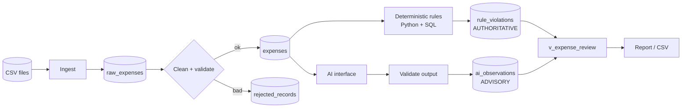

# Expense Policy Checker

A small data-engineering project: ingest messy expense CSVs into a **structured SQLite
dataset**, check them against a written policy with **deterministic rules**, and add
**advisory AI observations** for things rules cannot judge — *kept strictly separate*.

* Python 3.10+ **standard library only** · SQL (SQLite) · synthetic data only · no secrets
* Runs from a clean checkout in ~1 second: no downloads, no API keys, no network

## 1. Problem statement

Finance teams get expense claims as inconsistent files. Two kinds of checks are needed:

| Kind | Example | Must be |
|---|---|---|
| **Deterministic rule** | "Meals over USD 75 are not allowed" | exact, auditable, reproducible |
| **Judgement** | "Is *'Spa day'* a business expense?" | assistive only - a human decides |

Mixing them is dangerous (an LLM must never silently approve/deny a claim), so this project makes
the separation **structural**: different tables, different report sections, no code path from AI to PASS/FAIL.

## 2. Quick start

```bash
git clone <repo-url> && cd expense-policy-checker
python3 --version            # 3.10+ ; nothing to pip install
make test                    # 34 tests
make demo                    # full pipeline on sample data -> report + output/review_report.csv
make edge                    # failure / edge-case demonstration
```

Without `make`:

```bash
export PYTHONPATH=src        # (or: pip install -e .  then use `expense-checker ...`)
python3 -m unittest discover -s tests -t . -v
python3 -m expense_checker run --as-of 2026-10-15
python3 -m expense_checker edge-demo
```

Step by step: `init` → `ingest` → `check --as-of 2026-10-15` → `ai` → `report`
(`python3 -m expense_checker --help`). `--as-of` fixes the "processing date" so results are reproducible
(the sample data is anchored on 2026-10-15). Real sample output: [`docs/sample_output.txt`](docs/sample_output.txt).

### Optional: a real local model (free)

```bash
ollama pull llama3.2
cp .env.example .env         # set AI_PROVIDER=ollama   (.env is git-ignored)
python3 -m expense_checker ai
```

## 3. Architecture / data flow

Full diagram: [`docs/architecture.md`](docs/architecture.md)



Design decisions, trade-offs and production plan: [`docs/design_note.md`](docs/design_note.md).

## 4. Project structure

```
src/expense_checker/   ingest.py rules.py policy.py ai_review.py report.py pipeline.py cli.py generate_data.py
  └── ai/              base.py (interface) validation.py heuristic.py ollama.py
sql/                   schema.sql (tables+constraints)  views.sql (reporting views, window function)
data/sample/           synthetic CSVs (batch1 + batch2)    data/reference/fx_rates.csv
docs/                  policy.md  architecture.md  design_note.md  demo_script.md  sample_output.txt
tests/                 34 unittest tests (pytest-compatible)
.env.example           config keys (no secrets needed by default)
```

## 5. Data model

| Table / view | Purpose |
|---|---|
| `ingest_batches` | one row per file load, with counts |
| `raw_expenses` | RAW: every row as received (TEXT), `row_hash UNIQUE` → idempotent |
| `expenses` | CURATED: typed, `CHECK` constraints (category list, amount > 0, ISO dates, receipt 0/1) |
| `rejected_records` | bad rows + human-readable reason(s) |
| `fx_rates` | fixed conversion table (USD, EUR, GBP, INR) |
| `rule_violations` | **deterministic** failures `(expense_id, rule_id)` + policy version |
| `ai_observations` | **advisory** output: label, confidence, rationale, status, `needs_human_review` |
| `v_expenses_usd` | expenses joined to FX → `amount_usd` |
| `v_duplicate_claims` | R005 via `ROW_NUMBER()`/`FIRST_VALUE()` window functions |
| `v_expense_review` | one row per expense: `rule_status` and `ai_label` side by side, never merged |

## 6. Policy & rules

[`docs/policy.md`](docs/policy.md) defines R001-R009 (meal/lodging limits, receipt, prohibited category,
duplicates, approval > USD 500, late submission, future date, self-approval). Amounts are compared in USD.

## 7. Data engineering behaviour

* **Cleaning:** trims, `$1,020.50`→1020.50, three date formats, category aliases (`meal`→`Meals`), case-insensitive currency.
* **Invalid records:** blank / non-numeric / ≤0 amount, impossible date, unknown currency or category,
  missing IDs → `rejected_records` with reasons (7 in the sample). Never silently dropped.
* **Duplicates:** *exact re-sent rows* are skipped by `row_hash` (technical duplicates); *same claim under a new ID*
  is caught by rule R005 (business duplicates); same `expense_id` with different content is rejected.
* **Re-run safety:** ingest is idempotent, rules are fully recomputed, AI only reviews what is new. Batch 2 of the sample
  re-sends 8 rows → "skipped(dup)=8".
* **Schema problems:** a file missing columns raises `SchemaError` *before* any DB write.

## 8. AI component

* **Why AI here:** description-vs-category consistency, vagueness and "personal purchase" smell are text-judgement tasks.
* **Input to the model:** merchant, category, description, amount, currency — **no employee or approver IDs**.
* **Expected output:** JSON `{"label", "confidence", "rationale"}`, label ∈ `consistent | vague_description |
  possible_personal_expense | category_mismatch | no_business_purpose`.
* **Interface:** `PolicyReviewer.review(ReviewInput) -> str` (`ai/base.py`). Providers: `heuristic` (offline default,
  imitates an LLM's JSON contract), `ollama` (local LLM), `none`. Chosen by `AI_PROVIDER`.
* **Never trusted:** output goes through `ai/validation.py` (JSON, label whitelist, confidence 0-1, rationale present).
* **Bad output handling:** provider failure → `status=error`; malformed → `invalid_response`; confidence < `AI_MIN_CONFIDENCE`
  (0.6) → `low_confidence`. All set `needs_human_review=1`. Errors are retried next run. The run never fails because of the model.
* **Stored:** `ai_observations` only (with provider, model, prompt version). It cannot change `rule_violations`.

## 9. Tests (34)

`make test` — stdlib `unittest`, also runs under `pytest`.

| File | Covers |
|---|---|
| `test_rules.py` | every rule incl. boundary values (75.00 vs 75.01, 60 vs 61 days), determinism |
| `test_ingest.py` | cleaning helpers, **invalid rows**, **idempotent re-ingest**, incremental load, **conflicting ID**, **schema error** |
| `test_ai.py` | **malformed AI output**, **provider down + retry**, low-confidence, incremental, **AI cannot alter rule results** |
| `test_pipeline.py` | SQL duplicate rule, FX-driven limits, rule idempotency, end-to-end sample with pinned counts |

**Failure/edge-case demo:** `make edge` (schema error, bad value, rerun, garbage AI, offline AI).

## 10. Sample results (from `docs/sample_output.txt`)

* 131 rows read over 2 batches → **116 curated**, **7 rejected**, **8 skipped** as exact re-sends.
* **13 expenses FAIL** deterministic rules (R001×3, R002×3, R003, R004, R005, R006, R007, R008, R009); 103 PASS.
* AI independently surfaced **8 items that passed every rule** (gift, "misc", Netflix, Uber filed as Meals, spa, …),
  one of them `low_confidence` → flagged for human review.

## 11. Assumptions

Fixed FX rates · blank receipt = no receipt · refunds out of scope · policy thresholds in `policy.py` mirror `docs/policy.md`
· "processing date" defaults to today (`--as-of` overrides) · all data is synthetic (seeded generator: `make data`).

## 12. Known limitations / what I'd improve for production

* The heuristic provider is keyword logic, not a model — it demonstrates the contract, not accuracy.
* No amendment/versioning workflow for corrected claims; no per-person cumulative limits; no refunds.
* Full rule recompute each run (fine at this scale). Production: Postgres + incremental dbt models, versioned rules with
  effective dates, an evaluation set to measure the LLM before relying on it, a review-queue UI, PII controls,
  orchestration + alerting (e.g. rejection-rate spikes).

## 13. Secrets

No secrets in code or history. Config via environment / git-ignored `.env`; `.env.example` lists keys.
The default setup needs no credentials at all.
