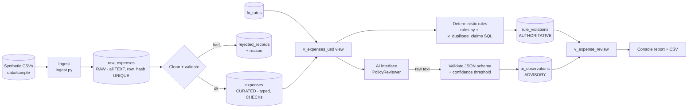

# Architecture / data flow



```
  CSV --> raw_expenses --clean--> expenses --> v_expenses_usd --+--> RULES (pure Python + SQL) --> rule_violations --+
                  \--> rejected_records                        |                                                    +--> v_expense_review --> report
                                                               +--> AI (interface -> validate -> store) --> ai_observations --+
```

**The two result tables never merge.** `v_expense_review` shows them side by side
(`rule_status` vs `ai_label`), but no code path derives PASS/FAIL from AI output.

## Module map

| Module | Responsibility |
|---|---|
| `ingest.py` | read CSV, hash rows, load RAW, clean to CURATED, record rejects |
| `rules.py` / `policy.py` | pure deterministic rules + thresholds |
| `ai/base.py` | `PolicyReviewer` interface (the only thing the pipeline sees) |
| `ai/validation.py` | strict parsing of model output |
| `ai/heuristic.py`, `ai/ollama.py` | offline stand-in, local-LLM provider |
| `ai_review.py` | orchestration, failure handling, incremental runs |
| `report.py`, `cli.py`, `pipeline.py` | presentation + wiring |
